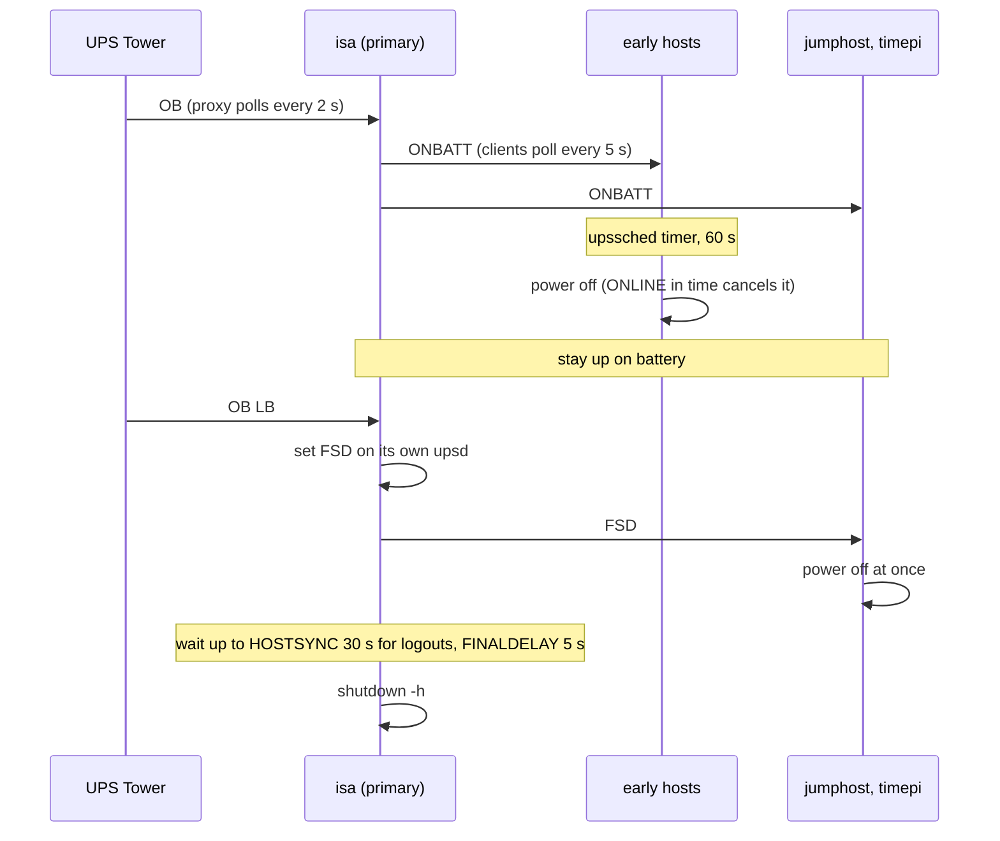

# How power-loss shutdown is ordered

Everything at home hangs off one Ubiquiti UPS Tower with roughly 19 minutes of battery at
today's load. The NUT setup spends that battery on the few hosts that matter during and right
after an outage, turns the rest off early, and lets isa, as the NUT primary, call the end.
Exact values are in [UPS and NUT](../reference/ups-and-nut.md).

## The sequence

The NAS isn't in this: DSM is a network UPS client of the UPS Tower itself and follows its own
settings. Home Assistant only reads the status.

## Why early and late

The early group is the big one: five labk3s Pis, three Ceph Pis, four blades and the NUC. None
of them is needed to get through an outage or to recover from one, and each drew battery for
nothing, so they go after a minute. A minute rides out a flicker without taking the cluster
down. How Ceph and labk3s come back afterwards is in their own docs.

The late hosts are the ones you want last: the jumphost is the way in, timepi is the LAN's
time source. isa outlasts them because it's the primary: it sets FSD, and upsmon on a primary
waits for its secondaries to log out before it shuts its own host down.

## Why isa is the primary

Until November 2026 nobody was. isa's upsmon was a secondary of the UPS Tower, and every client
a secondary of isa's proxy, so on low battery each host waited `HOSTSYNC` for an FSD that never
came and then shut down on its own clock, isa included. That works, but nothing ordered it,
and isa could go before the hosts reading the UPS through it.

As the primary of the proxied UPS on its own upsd (`ups@localhost`, user `admin`), isa sets the
FSD flag there. upsd adds that flag to `ups.status` itself, so it works on a dummy-ups repeater
even though the UPS Tower never hears about it. Every secondary sees FSD on its next poll.

If the primary fails anyway (isa down, or its upsmon not logged in), the old behaviour is the
fallback: secondaries see `OB LB`, wait 15 s, and shut down themselves. A client whose UPS
disappears while on battery also counts it as critical after `DEADTIME` (30 s). The Buckle
check `nut-server: primary` and the alert `UPS — metrics stale` are there so that state doesn't
last unnoticed.

## Why FSD waits for low battery

isa could force FSD after a fixed time on battery and have everything down long before the
battery is critical. It doesn't, because of kill-power (next section): nothing can tell this
UPS to cut its outlets after the hosts are down. With an early FSD, the halted hosts would sit
on a live UPS for many minutes, and if the mains came back in that time, they'd stay off until
someone cycled their power. Waiting for LB keeps jumphost, timepi and isa up through outages of
around 20 minutes, and drains the battery close to empty, so the outlets drop soon after the
hosts are down and come back with the mains.

The price is that the UPS's own LB threshold decides, and it isn't visible: the UPS exposes no
`battery.charge.low` or `battery.runtime.low`. That's why `UPS — less than 10 minutes of
battery left` pages first, and why `sudo upsmon -c fsd` on isa is the documented way to go
early by hand.

## Why there's no kill-power

NUT's kill-power has the primary write a flag file, and the system's last shutdown step
(`nutshutdown`) runs the driver once more to switch the UPS off after a delay. Through isa's
proxy that can't be trusted:

- the driver is dummy-ups, run at the very end of isa's shutdown, when its network route to the
  UPS Tower may already be gone;
- the UPS Tower has no delayed shutdown. Its instant commands are `load.off`, `load.on`,
  `shutdown.reboot` and `test.battery.start`, with no `ups.delay.shutdown`, so the only way to
  cut the load is at once, which would also cut the NAS in the middle of its own shutdown.

So isa's upsmon has no `POWERDOWNFLAG` and `nutshutdown` does nothing. The consequence is the
classic power race: if the mains return after the hosts have shut down but before the battery
is empty, the outlets never lose power and the hosts that powered off stay off. Waiting for LB
makes that window short. If it happens, cycle their power by hand.

## Why a proxy at all

The catalog's reason is that the fifteen clients shouldn't all poll the UPS. The proxy also
gives them one name, `svc:nut`, that can move to another host without touching a client.
Home Assistant stays on the LAN because `tag:smarthome` has no grant to `svc:nut`.

## Still unverified

!!! warning "No full power cut has happened under this config"
    The NUT journals on isa (10 days) and a Pi (30 days, as of 2026-11-26) show no power
    event. The sequence above is what the config and NUT's documented upsmon behaviour say,
    not something anyone has watched end to end.
