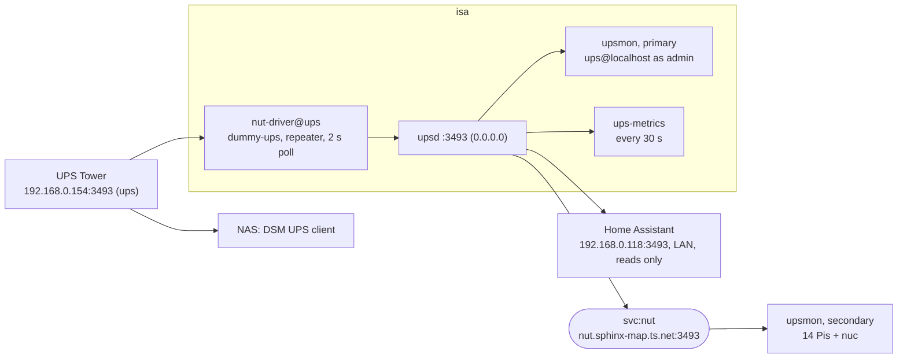

# UPS and NUT

Sources: [modules/nut-server](https://github.com/SpechtLabs/homelab/tree/main/modules/nut-server),
[modules/nut-client](https://github.com/SpechtLabs/homelab/tree/main/modules/nut-client),
[vars/defaults.yaml](https://github.com/SpechtLabs/homelab/blob/main/vars/defaults.yaml) and the
groups in [buckle.yaml](https://github.com/SpechtLabs/homelab/blob/main/buckle.yaml). UPS values
from `upsc ups@localhost` on isa, 2026-11-26.

## The UPS

| | |
|---|---|
| Model | Ubiquiti `TOWER_1000VA_230V`, line-interactive, 1000 VA / 600 W nominal |
| Address | 192.168.0.154 (`UPSTower.local`), NUT on 3493 with SSL, UPS name `ups` |
| Logins | accepts any; reading it needs none, and isa's proxy only reads |
| Instant commands | `load.off`, `load.on`, `shutdown.reboot`, `test.battery.start` (`upscmd -l ups@192.168.0.154`); no `ups.delay.shutdown`, no `battery.charge.low` or `battery.runtime.low` |
| Runtime | `battery.runtime` 1157 s (about 19 min) at `ups.load` 22 % with everything on it |
| Self-test | weekly (`ups.test.interval` 604800); last 2026-11-25, `done and passed` |

## The chain

upsd sees every `svc:nut` client as `127.0.0.1`, and isa's own upsmon too; it authenticates by
user and password, so that's fine. `upsc -c ups@localhost` on isa lists one `127.0.0.1` line
per logged-in upsmon: 16 with every Pi, the NUC and isa's primary up. Home Assistant only reads
variables and doesn't log in, so it isn't counted and doesn't take part in the shutdown.

The FSD flag lives in isa's upsd, not in the UPS: `upsc ups@localhost ups.status` shows it,
`upsc ups@192.168.0.154` doesn't. The NAS watches the UPS Tower directly and never sees it.

## Who shuts down when

| Hosts | Buckle setting | On battery (`ONBATT`) | `FSD` seen | `FINALDELAY` |
|---|---|---|---|---|
| clusterpi-leader, clusterpi-worker1..4, storagepi-ceph1..3, blade-pi1..4, nuc | `nut-client`, `nut_shutdown_affinity: early` | upssched starts timer `onbatt_shutdown`, 60 s (`nut_onbatt_grace`); then `systemctl poweroff -i`. `ONLINE` cancels it | `immediate_shutdown`: `systemctl poweroff -i` | 5 s |
| jumphost, timepi | `nut-client` + `nut-late` (affinity `late`) | nothing | `delayed_shutdown`: `systemctl poweroff -i` right away | 180 s |
| isa | `nut-server`: primary | nothing | it sets FSD itself, on `OB LB`; then waits up to `HOSTSYNC` (30 s, `nut_hostsync`) for the secondaries to log out, then `FINALDELAY`, then `SHUTDOWNCMD` | 5 s (`nut_finaldelay`) |
| NAS | DSM, not Buckle | DSM's own UPS settings (Control Panel, not in the repo) | doesn't see isa's FSD | |
| Home Assistant | not managed | reads UPS status only; nothing shuts it down | | |

`SHUTDOWNCMD` is `/sbin/shutdown -h +0` everywhere. A secondary that sees `OB LB` without FSD
(isa's primary gone) waits `HOSTSYNC` (15 s), then shuts down on its own after its
`FINALDELAY`. There's no FSD on a timer and no kill-power; why is in
[How power-loss shutdown is ordered](../explanation/power-loss-shutdown.md).

## upsmon settings

| Setting | Clients (`nut-client`) | isa (`nut-server`) |
|---|---|---|
| `MONITOR` | `ups@nut.sphinx-map.ts.net 1 monuser <NUT_MONITOR_PASSWORD> secondary` | `ups@localhost 1 admin <NUT_ADMIN_PASSWORD> primary` |
| `POLLFREQ` / `POLLFREQALERT` | 5 / 5 | 5 / 5 |
| `HOSTSYNC` | 15 | 30 (`nut_hostsync`) |
| `DEADTIME` | 30 | 15 |
| `NOCOMMWARNTIME` | 300 | 300 |
| `RBWARNTIME` | 43200 | 43200 |
| `FINALDELAY` | 5 (early), 180 (late) | 5 (`nut_finaldelay`) |
| `POWERDOWNFLAG` | `/etc/nut/killpower` (a secondary never writes it) | none, on purpose |
| `NOTIFYCMD` | `/sbin/upssched` | none |
| `NOTIFYFLAG` | `ONLINE`, `ONBATT`, `FSD`: `SYSLOG+EXEC` | defaults |
| `RUN_AS_USER` | root | default |

## Files

| Host | File | Template |
|---|---|---|
| isa | `/etc/nut/nut.conf` (`MODE=netserver`) | [nut-server/files/nut.conf.j2](https://github.com/SpechtLabs/homelab/blob/main/modules/nut-server/files/nut.conf.j2) |
| isa | `/etc/nut/ups.conf` (`dummy-ups`, `port = ups@192.168.0.154`) | [ups.conf.j2](https://github.com/SpechtLabs/homelab/blob/main/modules/nut-server/files/ups.conf.j2) |
| isa | `/etc/nut/upsd.conf` | [upsd.conf.j2](https://github.com/SpechtLabs/homelab/blob/main/modules/nut-server/files/upsd.conf.j2) |
| isa | `/etc/nut/upsd.users` | [upsd.users.j2](https://github.com/SpechtLabs/homelab/blob/main/modules/nut-server/files/upsd.users.j2) |
| isa | `/etc/nut/upsmon.conf` | [nut-server/files/upsmon.conf.j2](https://github.com/SpechtLabs/homelab/blob/main/modules/nut-server/files/upsmon.conf.j2) |
| isa | `/usr/local/sbin/ups-metrics`, `ups-metrics.service`, `ups-metrics.timer` | [ups-metrics.py](https://github.com/SpechtLabs/homelab/blob/main/modules/nut-server/files/ups-metrics.py) |
| isa | `/var/lib/prometheus/node-exporter/ups.prom` | written by `ups-metrics` |
| clients | `/etc/nut/nut.conf` (`MODE=netclient`) | [nut-client/files/nut.conf.j2](https://github.com/SpechtLabs/homelab/blob/main/modules/nut-client/files/nut.conf.j2) |
| clients | `/etc/nut/upsmon.conf` | [nut-client/files/upsmon.conf.j2](https://github.com/SpechtLabs/homelab/blob/main/modules/nut-client/files/upsmon.conf.j2) |
| clients | `/etc/nut/upssched.conf` | [upssched.conf.j2](https://github.com/SpechtLabs/homelab/blob/main/modules/nut-client/files/upssched.conf.j2) |
| clients | `/etc/nut/upssched-cmd` | [upssched-cmd.j2](https://github.com/SpechtLabs/homelab/blob/main/modules/nut-client/files/upssched-cmd.j2) |
| clients | `/usr/local/sbin/nut-client-metrics`, `nut-client-metrics.service`, `nut-client-metrics.timer` | [nut-client-metrics.py](https://github.com/SpechtLabs/homelab/blob/main/modules/nut-client/files/nut-client-metrics.py) |
| clients | `/var/lib/prometheus/node-exporter/nut-client.prom` | written by `nut-client-metrics` |

The NUT files are `root:nut`, mode 0640 (`upssched-cmd` 0750): read them with `sudo`.

Units: `nut-server`, `nut-monitor`, `nut-driver@ups` and `ups-metrics.timer` on isa;
`nut-monitor` and `nut-client-metrics.timer` on the clients.

## Users and secrets

| upsd user | Rights | Who logs in | Password (on the Buckle server, `/etc/buckle/secrets/`) |
|---|---|---|---|
| `admin` (`nut_admin_user`) | `actions = set, fsd`, `instcmds = all`, `upsmon primary` | isa's upsmon | `NUT_ADMIN_PASSWORD` |
| `monuser` (`nut_monitor_user`) | `upsmon secondary` | the Pis and the NUC | `NUT_MONITOR_PASSWORD` |

Rotating the NUT passwords changes both ends; they're in the same revision, so one rollout does
it ([bootstrap/README.md](https://github.com/SpechtLabs/homelab/blob/main/bootstrap/README.md)).

## Vars

| Var | Value | Defined in |
|---|---|---|
| `nut_server_host` | `nut.{{ vars.tailnet }}` | vars/defaults.yaml |
| `nut_ups_name` | `ups` | vars/defaults.yaml |
| `nut_upstream_host` | `192.168.0.154` | nut-server module.yaml |
| `nut_admin_user` / `nut_monitor_user` | `admin` / `monuser` | nut-server (`nut_monitor_user` also in nut-client) |
| `nut_listen` | `0.0.0.0` | nut-server |
| `nut_hostsync` | `30` | nut-server |
| `nut_finaldelay` | `5` | nut-server |
| `nut_shutdown_affinity` | `early`; `late` for group `nut-late` | nut-client; buckle.yaml |
| `nut_onbatt_grace` | `60` | nut-client |

## Health checks

| Module | Check | What it runs | Required |
|---|---|---|---|
| nut-server | `upsd` | TCP connect to `127.0.0.1:3493` | yes |
| nut-server | `proxied-ups` | `upsc ups@localhost ups.status` exits 0 | yes |
| nut-server | `upstream-ups` | `upsc ups@192.168.0.154 ups.status` exits 0: `dummy-ups` keeps serving its last values when it loses the UPS Tower, so `proxied-ups` alone passes | yes |
| nut-server | `primary` | `nut-monitor` active, and this boot's last upsd log line for `admin@` is `logged into UPS [ups]` | yes |
| nut-server | `svc-nut` | `upsc ups@nut.sphinx-map.ts.net ups.status` exits 0 | no (a fresh host can beat the policy that approves it) |
| nut-server | `metrics` | `ups.prom` younger than 3 min with `ups_metrics_up{ups="ups"} 1` | no |
| nut-client | `monitor` | `nut-monitor` active for 30 s | yes |
| nut-client | `ups-reachable` | `upsc ups@nut.sphinx-map.ts.net ups.status` exits 0 | yes |

## Metrics

From `ups-metrics` on isa, every 30 s, all with `ups="ups"` (plus `job="integrations/unix"`,
`instance="isa:9100"`). The alerts are in [Monitoring](monitoring.md#alerts), the dashboard is
`UPS & NUT` (uid `ups-nut`, folder Infrastructure).

| Metric | From |
|---|---|
| `ups_status{flag}` | `ups.status`: 0 or 1 for `OL`, `OB`, `LB`, `FSD`, `RB`, `CHRG`, `DISCHRG`, `OFF`, `OVER`, `BYPASS`, and any other flag while it's set |
| `ups_battery_charge_percent`, `ups_battery_runtime_seconds`, `ups_battery_voltage_volts` | `battery.charge`, `battery.runtime`, `battery.voltage` |
| `ups_load_percent`, `ups_realpower_watts` | `ups.load`, `ups.realpower` |
| `ups_input_voltage_volts`, `ups_input_frequency_hertz`, `ups_output_voltage_volts` | `input.voltage`, `input.frequency`, `output.voltage` |
| `ups_temperature_celsius` | `ups.temperature` |
| `ups_test_failed`, `ups_test_last_timestamp_seconds` | `ups.test.result` (1 if it mentions fail, error or warn), `ups.test.date` |
| `ups_clients` | lines of `upsc -c ups@localhost` |
| `ups_primary_monitor_up` | `systemctl is-active nut-monitor` on isa: the primary upsmon runs (logged in is the Buckle check `primary`) |
| `ups_metrics_up`, `ups_metrics_last_success_timestamp_seconds`, `ups_metrics_duration_seconds` | the read itself; a failed read keeps the last success's timestamp. It also reads `ups.status` from the UPS Tower directly: unreachable, or OL/OB differing from the proxy's, is a failed read |

From `nut-client-metrics` on every NUT client, every 30 s, all with `ups="ups"` (plus
`job="integrations/unix"`, `instance="<host>:9100"`). upsd sees every client as `127.0.0.1`
behind `svc:nut`, so these are what name a missing host.

| Metric | From |
|---|---|
| `nut_client_monitor_up` | `systemctl is-active nut-monitor` |
| `nut_client_ups_reachable`, `nut_client_ups_read_duration_seconds` | `upsc ups@nut.sphinx-map.ts.net ups.status` exits 0 with output; how long it took |
| `nut_client_info{affinity, server}` | `nut_shutdown_affinity` and `nut_server_host` |
| `nut_client_onbatt_grace_seconds` | `nut_onbatt_grace`, early hosts only |
| `nut_client_finaldelay_seconds` | upsmon's `FINALDELAY` |
| `nut_client_metrics_timestamp_seconds` | when the file was written |

## `ups.status` values you'll see

`OL` on line power, `OB` on battery, `LB` battery low, `FSD` forced shutdown in progress, often
with `CHRG` or `DISCHRG`; `RB` if the UPS wants a new battery. `OB LB` together is what upsmon
treats as critical.
