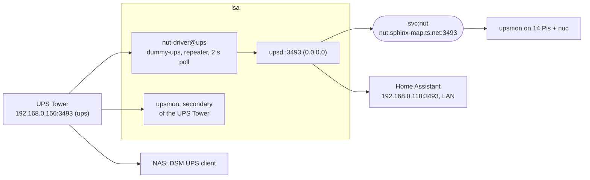

# UPS and NUT

Sources: [modules/nut-server](https://github.com/SpechtLabs/homelab/tree/main/modules/nut-server),
[modules/nut-client](https://github.com/SpechtLabs/homelab/tree/main/modules/nut-client),
[vars/defaults.yaml](https://github.com/SpechtLabs/homelab/blob/main/vars/defaults.yaml) and the
groups in [buckle.yaml](https://github.com/SpechtLabs/homelab/blob/main/buckle.yaml). Live values
from `upsc ups@localhost` on isa, 2026-11-26.

## The UPS

| | |
|---|---|
| Model | Ubiquiti `TOWER_1000VA_230V`, line-interactive, 1000 VA / 600 W nominal |
| Address | 192.168.0.156 (`UPSTower.local`), NUT on 3493 with SSL, UPS name `ups` |
| Logins | accepts any; the fleet uses `monuser` with `NUT_UPSTREAM_PASSWORD` |
| Runtime | `battery.runtime` 1157 s (about 19 min) at `ups.load` 22 % with everything on it |
| Self-test | weekly (`ups.test.interval` 604800); last 2026-11-25, `done and passed` |

## The chain

upsd sees every `svc:nut` client as `127.0.0.1`; it authenticates by user and password, so
that's fine. `upsc -c ups@localhost` on isa lists one `127.0.0.1` line per logged-in client
(15 on 2026-11-26).

## Who shuts down when

| Hosts | Buckle setting | On battery (`ONBATT`) | `FSD` seen | UPS critical (`OB LB`), handled by upsmon | `FINALDELAY` |
|---|---|---|---|---|---|
| clusterpi-leader, clusterpi-worker1..4, storagepi-ceph1..3, blade-pi1..4, nuc | `nut-client`, `nut_shutdown_affinity: early` | upssched starts timer `onbatt_shutdown`, 60 s (`nut_onbatt_grace`); then `systemctl poweroff -i`. `ONLINE` cancels it | `immediate_shutdown`: `systemctl poweroff -i` | `SHUTDOWNCMD` after `FINALDELAY` | 5 s |
| jumphost, timepi | `nut-client` + `nut-late` (affinity `late`) | nothing | `delayed_shutdown`: `systemctl poweroff -i` right away (the name says delayed; the script isn't) | `SHUTDOWNCMD` after `FINALDELAY` | 180 s |
| isa | `nut-server` (`nut_finaldelay: 180`) | nothing (no `NOTIFYCMD`) | logged to syslog only | `SHUTDOWNCMD` after `FINALDELAY` | 180 s |
| NAS | DSM, not Buckle | DSM's own UPS settings (Control Panel, not in the repo) | | | |
| Home Assistant | not managed | reads UPS status only; nothing in the repo shuts it down | | | |

`SHUTDOWNCMD` is `/sbin/shutdown -h +0` everywhere. The reasoning behind the order is in
[How power-loss shutdown is ordered](../explanation/power-loss-shutdown.md).

## upsmon settings

| Setting | Clients (`nut-client`) | isa (`nut-server`) |
|---|---|---|
| `MONITOR` | `ups@nut.sphinx-map.ts.net 1 monuser <NUT_MONITOR_PASSWORD> secondary` | `ups@192.168.0.156 1 monuser <NUT_UPSTREAM_PASSWORD> secondary` |
| `POLLFREQ` / `POLLFREQALERT` | 5 / 5 | 5 / 5 |
| `HOSTSYNC` | 15 | 15 |
| `DEADTIME` | 30 | 15 |
| `NOCOMMWARNTIME` | 300 | 300 |
| `RBWARNTIME` | 43200 | 43200 |
| `FINALDELAY` | 5 (early), 180 (late) | 180 |
| `POWERDOWNFLAG` | `/etc/nut/killpower` | `/etc/killpower` |
| `OFFDURATION` | | 30 |
| `NOTIFYCMD` | `/sbin/upssched` | none |
| `NOTIFYFLAG` | `ONLINE`, `ONBATT`, `FSD`: `SYSLOG+EXEC` | `FSD`: `SYSLOG+EXEC` |
| `RUN_AS_USER` | root | default |

## Files

| Host | File | Template |
|---|---|---|
| isa | `/etc/nut/nut.conf` (`MODE=netserver`) | [nut-server/files/nut.conf.j2](https://github.com/SpechtLabs/homelab/blob/main/modules/nut-server/files/nut.conf.j2) |
| isa | `/etc/nut/ups.conf` (`dummy-ups`, `port = ups@192.168.0.156`) | [ups.conf.j2](https://github.com/SpechtLabs/homelab/blob/main/modules/nut-server/files/ups.conf.j2) |
| isa | `/etc/nut/upsd.conf` | [upsd.conf.j2](https://github.com/SpechtLabs/homelab/blob/main/modules/nut-server/files/upsd.conf.j2) |
| isa | `/etc/nut/upsd.users` | [upsd.users.j2](https://github.com/SpechtLabs/homelab/blob/main/modules/nut-server/files/upsd.users.j2) |
| isa | `/etc/nut/upsmon.conf` | [nut-server/files/upsmon.conf.j2](https://github.com/SpechtLabs/homelab/blob/main/modules/nut-server/files/upsmon.conf.j2) |
| clients | `/etc/nut/nut.conf` (`MODE=netclient`) | [nut-client/files/nut.conf.j2](https://github.com/SpechtLabs/homelab/blob/main/modules/nut-client/files/nut.conf.j2) |
| clients | `/etc/nut/upsmon.conf` | [nut-client/files/upsmon.conf.j2](https://github.com/SpechtLabs/homelab/blob/main/modules/nut-client/files/upsmon.conf.j2) |
| clients | `/etc/nut/upssched.conf` | [upssched.conf.j2](https://github.com/SpechtLabs/homelab/blob/main/modules/nut-client/files/upssched.conf.j2) |
| clients | `/etc/nut/upssched-cmd` | [upssched-cmd.j2](https://github.com/SpechtLabs/homelab/blob/main/modules/nut-client/files/upssched-cmd.j2) |

All are `root:nut`, mode 0640 (`upssched-cmd` 0750): read them with `sudo`.

Units: `nut-server`, `nut-monitor` and `nut-driver@ups` on isa; `nut-monitor` on the clients.

## Users and secrets

| upsd user | Rights | Password (on the Buckle server, `/etc/buckle/secrets/`) |
|---|---|---|
| `admin` (`nut_admin_user`) | `actions = set, fsd`, `instcmds = all`, `upsmon primary` | `NUT_ADMIN_PASSWORD` |
| `monuser` (`nut_monitor_user`) | `upsmon secondary` | `NUT_MONITOR_PASSWORD` |

`NUT_UPSTREAM_PASSWORD` is isa's login to the UPS Tower. Rotating the NUT passwords changes both
ends; they're in the same revision, so one rollout does it
([bootstrap/README.md](https://github.com/SpechtLabs/homelab/blob/main/bootstrap/README.md)).

## Vars

| Var | Value | Defined in |
|---|---|---|
| `nut_server_host` | `nut.{{ vars.tailnet }}` | vars/defaults.yaml |
| `nut_ups_name` | `ups` | vars/defaults.yaml |
| `nut_upstream_host` | `192.168.0.156` | nut-server module.yaml |
| `nut_upstream_user` | `monuser` | nut-server |
| `nut_admin_user` / `nut_monitor_user` | `admin` / `monuser` | nut-server (`nut_monitor_user` also in nut-client) |
| `nut_listen` | `0.0.0.0` | nut-server |
| `nut_finaldelay` | `180` | nut-server |
| `nut_shutdown_affinity` | `early`; `late` for group `nut-late` | nut-client; buckle.yaml |
| `nut_onbatt_grace` | `60` | nut-client |

## Health checks

| Module | Check | What it runs | Required |
|---|---|---|---|
| nut-server | `upsd` | TCP connect to `127.0.0.1:3493` | yes |
| nut-server | `proxied-ups` | `upsc ups@localhost ups.status` exits 0 | yes |
| nut-server | `svc-nut` | `upsc ups@nut.sphinx-map.ts.net ups.status` exits 0 | no (a fresh host can beat the policy that approves it) |
| nut-client | `monitor` | `nut-monitor` active for 30 s | yes |
| nut-client | `ups-reachable` | `upsc ups@nut.sphinx-map.ts.net ups.status` exits 0 | yes |

There's no Grafana alert on UPS state or on NUT; these checks, in Buckle, are the only watch.

## `ups.status` values you'll see

`OL` on line power, `OB` on battery, `LB` battery low, `FSD` forced shutdown in progress, often
with `CHRG` or `DISCHRG`. `OB LB` together is what upsmon treats as critical.
