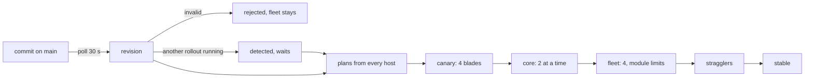

# How a revision becomes a rollout

A commit on `main` is a deploy. Nobody approves anything by hand: every phase has
`approval: auto`, Renovate merges its own PRs, and the gates are CI before the merge and health
checks after it. This page explains how those gates fit together, so that a pause or a stuck
commit makes sense when it happens.

## From commit to revision

The server keeps a clone of the repo and fetches `main` every 30 s. Each new commit becomes a
revision: exported, loaded and validated. An invalid one is stored as rejected, shown with its
errors, and nothing rolls out. The server's validation is narrower than `buckle validate` (it
doesn't resolve task kinds or dry-plan hosts), which is why CI runs the full validate with every
host's fixture: a bad task kind that passes the server fails as a plan error on the hosts that
select it.

## Queueing: why a pause blocks everything

`supersede: latest` means a rollout always finishes before the next starts, and only the newest
waiting revision goes next; anything in between is skipped. A paused rollout hasn't finished. So
while it's paused, every later commit sits at `detected`, and a scheduled run waits up to its 2 h
window and then skips. It has happened here: a failed Ceph health gate left a nightly upgrade
paused, and the config rollouts behind it stayed at `detected` until it was aborted.

The upside is that the fleet never runs two revisions' rollouts at once, and a fix pushed during a
pause supersedes everything queued before it.

## Phases and waves

When a rollout starts, the server freezes its targets: each host goes into the first phase whose
selector matches (`canary` for the blades, `core` for isa, the NUC, timepi and jumphost, `fleet`
for the rest), and every host is asked for its plan up front. A host with nothing to change goes
healthy in seconds, which is why a typical commit finishes in under two minutes.

The order is about blast radius. The four blades carry nothing else depends on, so they go
together and prove the revision. `core` holds what everything leans on (the Buckle server itself,
tsidp, the NUT proxy, the collector, time, the jump host); two at a time, because none of them needs
another of them up to come back. Running isa early also means Buckle upgrades its server before
most of its agents, as Buckle recommends. Everything else is one `fleet` phase of four, and the
modules decide what may run together:

- A module's `parallel` counts every host that runs the module while its plan changes anything,
  whatever module changes it. `ceph` and `k3s-agent` both say 1, so a reboot from `base` or
  `pi-firmware` still takes one Ceph host, or one worker, at a time.
- `k3s-agent` needs `group:k3s-server`: the workers wait for the k3s server even inside the phase.

These limits replaced separate `k3s-server`, `k3s-agents` and `ceph` phases from the first design.
One dense phase with module limits rolls Ceph and k3s side by side instead of one after the other.

## Health is the gate

There's no bake window (`health.bake: 0s`, set explicitly because Buckle's default is 5 min).
A host counts as healthy once its required checks pass after the apply; a check that keeps failing
for `settle` (2 min) fails the host. Before each phase starts, every host the rollout already
updated is checked again, so a regression in `canary` stops `core` from starting.

Before a host's own wave, its current checks run too (`health.baseline: hold`). A host already
sick before the change is held for an operator rather than blamed for it.

The checks are written to mean "this host can do its job": `ceph/cluster` waits until every OSD
and mon is back and no data is degraded, `k3s-agent/kubelet` until the kubelet serves, the k3s
server's until the API answers. That's how the nightly reboots go one Ceph host at a time without
ever leaving a placement group below `min_size`.

## Node maintenance

`labk3s` declares `maintenance: { drain: disruptive, deadline: 10m }`. A run that reboots a k3s
node, or changes a module marked `disrupts: node` (`k3s-server`, `k3s-agent`), first has the
cluster's executor cordon and drain the node, then applies, then uncordons it once the host is
healthy. The drain holds the host's slot, so the next worker waits. The feature came from cedi's
SierraSoftworks/buckle#907, released in 2.22.0.

It applies to rollouts only: commit rollouts, action rollouts and schedules. An action run from a
host's page goes straight to the host without a drain. And in 2.22, the Kubernetes drain evicts
once without waiting for the pods to leave; SierraSoftworks/buckle#908 adds the wait.

## When something fails

On the host, a module that fails (a task errors, or a required check stays red past `settle`) stops
the run, and the agent rolls that module back to the stable revision; modules that applied and
passed stay. On the server, `on_failure: pause` stops the rollout from starting anything else. From
there it's an operator's call: retry, skip, waive a check, roll back or abort
([Fix a paused rollout](../how-to/fix-a-paused-rollout.md)).

When the last phase completes, the revision is promoted to stable. Hosts that missed their phase
(offline, held, skipped) converge afterwards in `stragglers`, one at a time. New hosts get the
stable revision.

## Between rollouts

Every agent re-plans its applied revision every 15 minutes and corrects drift: a hand edit to a
managed file is undone, a stopped service started. Drift correction never removes anything and
never reboots; those wait for a rollout. When the server is down, agents keep enforcing the
revision they have, which is why the server's 99.5% SLO is looser than tsidp's.
