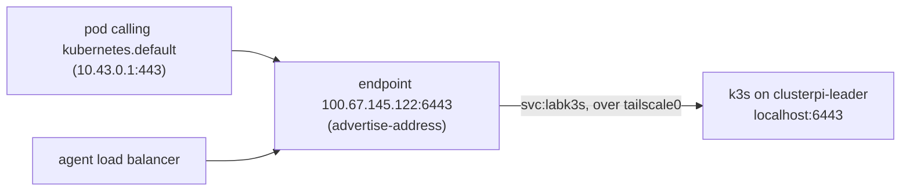

# k3s over the tailnet

Until 2026-11-26 labk3s spoke over the home LAN: node IPs and flannel on `192.168.0.x`. Now every byte between nodes, and every call to the API, goes over Tailscale. Each node registers with its tailnet IPv4 (`node-ip: host.facts.tailscale.ips[0]`), flannel builds its VXLAN on `tailscale0`, and the API is reachable only through the Tailscale Service `svc:labk3s`.

## What it buys

The commits don't record one single reason, but the effect on the policy is plain. The cluster's own traffic now passes through the tailnet policy, which says exactly who talks to whom: `tag:k3s-node` to `tag:k3s-node` on udp 8472, tcp 10250 and tcp 8681, `tag:k3s-node` to `svc:labk3s` on tcp 6443, and nothing else over the tailnet. A compute blade or Backstage's egress proxy that tries a node's kubelet or the server's 6443 gets dropped, and policy tests check that on every change. It's also the model Ceph already used (it speaks only on `100.64.0.0/10`), so the nodes reach Ceph and each other on the same network. The nodes are still on the LAN too; what listens on all interfaces is still reachable there.

The API moved behind a Service for the same reason the rest of the homelab did: grants name `svc:labk3s`, not a machine, so the server can move or a second server can join without touching a client or a grant.

## The advertise-address is the Service's VIP

At first (`760a24a`) the server advertised its own tailnet IP. That address becomes the endpoint of the in-cluster `kubernetes` Service, and it's what each agent's built-in load balancer learns and connects to after joining. So the agents joined through `svc:labk3s` and then bypassed it, and pods calling `kubernetes.default` went straight to the node. That needed a grant to `tag:k3s-server`, a tag destination, which didn't fit the policy's rule that destinations are Services.

Since `3ad28d7` the server sets `advertise-address` to `svc:labk3s`'s VIP, `100.67.145.122` (var `k3s_service_ip`). Now the `kubernetes` endpoint *is* the Service, every agent connection and pod API call goes through it, and the grant to `tag:k3s-server` is gone; a policy test denies `tag:k3s-node` to `tag:k3s-server:6443`. The leader reaches its own Service fine (hairpin works on Tailscale 1.104.7).

The catch: the VIP is pinned in the config. It stays stable while the Service exists, and the `svc-ip` health check fails if MagicDNS ever returns something else. If someone deletes and re-creates `svc:labk3s` in the admin console, it gets a new VIP, and the cluster advertises a dead address until `k3s_service_ip` follows.

## MTU 1230

`tailscale0` has an MTU of 1280. VXLAN adds 50 bytes of headers, and flannel sizes `flannel.1` from its interface, so pod traffic runs at 1230. Nothing sets this by hand; it falls out of `flannel-iface: tailscale0`. Expect it in `ip link` and in any pod that does path-MTU-sensitive things.

## Starting k3s needs Tailscale first

`node-ip` and `flannel-iface` both refer to `tailscale0`, so k3s can't start before tailscaled has an address. Both units wait up to 120 s for a `100.x` IPv4 on `tailscale0` (`ExecStartPre`) and order themselves after `tailscaled.service`. A node whose tailscaled is broken now looks like a node whose k3s won't start.

## Changing how the nodes connect

flannel's VXLAN only works between nodes that agree on where the others are. A node on the LAN sends to the other nodes' LAN addresses; a node on the tailnet sends to their `100.x` addresses on `tailscale0`. While some nodes are on one and some on the other, pods on the two halves can't reach each other.

That's why the usual rollout (drain one node, change it, wait for health, next) is the wrong tool here: with five nodes and drains it would leave the cluster split for about half an hour. For the switch on 2026-11-26 both modules dropped `disrupts: node` and `k3s-agent` went to `parallel: 4` for one commit (`a0fac78`), relying on `KillMode=process` to keep pods running while k3s restarted underneath them. Buckle still took the nodes about one every 2 minutes, so the cluster ran mixed for roughly 10 minutes, and it worked. The next commit (`28faf75`) restored drains and one worker at a time.

Any future change to `node-ip`, `flannel-iface` or the network the nodes use needs the same treatment, and afterwards the hostNetwork pods that captured the old address at start (the ceph-csi node plugin's metrics on 8681) need a restart: [Restart pods after the nodes change address](../how-to/restart-pods-after-the-nodes-change-address.md).
