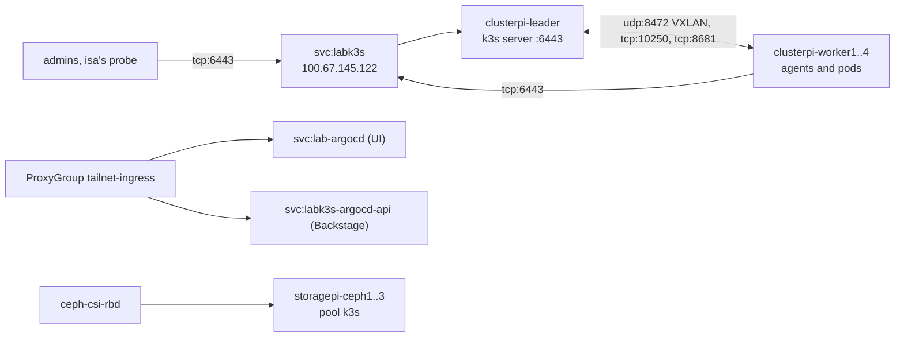

# labk3s

labk3s is the k3s cluster at home: one server, `clusterpi-leader` (Raspberry Pi 5), and four workers, `clusterpi-worker1` to `clusterpi-worker4` (Raspberry Pi 4). It runs entirely over the tailnet. Every node's address is its tailnet IPv4, flannel's VXLAN runs on `tailscale0`, and the Kubernetes API is reachable only through the Tailscale Service `svc:labk3s` at `https://labk3s.sphinx-map.ts.net:6443`.

Two tools share the work, and they never manage the same object:

- **Buckle** (this repo) installs and configures k3s on the five Pis, seeds Argo CD once on a cluster that has none, and owns the root Argo CD Application `1-meta-labk3s`.
- **Argo CD** deploys everything else from [SpechtLabs/k8s-deployment](https://github.com/SpechtLabs/k8s-deployment) (`argo-apps/labk3s/`), itself included, with self-heal on.

## Where to start

| You want to | Go to |
|---|---|
| Run `kubectl` against the cluster | [Get kubectl access](how-to/get-kubectl-access.md) |
| Change what runs on it | [Deploy or change an app](how-to/deploy-or-change-an-app.md) |
| Handle an alert that fired | [Respond to a labk3s alert](how-to/respond-to-a-labk3s-alert.md) |
| Reboot, upgrade or add a node | [How-to guides](how-to/index.md) |
| Look up a port, tag, var or file | [Reference](reference/index.md) |
| Understand why it's built this way | [Explanation](explanation/index.md) |
| Get your bearings on a first visit | [Tour the cluster](tutorials/tour-the-cluster.md) |

## Parts

| Part | Where it's defined |
|---|---|
| k3s server and agents | [`modules/k3s-server`](https://github.com/SpechtLabs/homelab/blob/main/modules/k3s-server/module.yaml), [`modules/k3s-agent`](https://github.com/SpechtLabs/homelab/blob/main/modules/k3s-agent/module.yaml) |
| Cluster declaration, drains, rollout phases | [`buckle.yaml`](https://github.com/SpechtLabs/homelab/blob/main/buckle.yaml) (`fleet.clusters.labk3s`, `rollout`) |
| k3s version | [`vars/versions.yaml`](https://github.com/SpechtLabs/homelab/blob/main/vars/versions.yaml) (`k3s_version`) |
| Argo CD seed | [`modules/argocd-seed`](https://github.com/SpechtLabs/homelab/blob/main/modules/argocd-seed/module.yaml) |
| Root Application | [`workloads/argocd-root`](https://github.com/SpechtLabs/homelab/blob/main/workloads/argocd-root/files/1-meta-labk3s.yaml) |
| Everything Argo CD deploys | [k8s-deployment `argo-apps/labk3s/`](https://github.com/SpechtLabs/k8s-deployment/tree/main/argo-apps/labk3s) and `apps/*/cluster/labk3s/` |
| Tailnet grants for the nodes and Services | [`tailscale/policy.hujson`](https://github.com/SpechtLabs/homelab/blob/main/tailscale/policy.hujson), rendered by Backstage from the catalog |

Related systems: the [tailnet](https://backstage.k8s.specht-labs.de/docs/default/system/tailnet/) (policy, tsidp), the [fleet](https://backstage.k8s.specht-labs.de/docs/default/system/fleet/) (Buckle itself, enrolment) and [Ceph](https://backstage.k8s.specht-labs.de/docs/default/system/ceph/) (the storage behind `ceph-rbd`).
