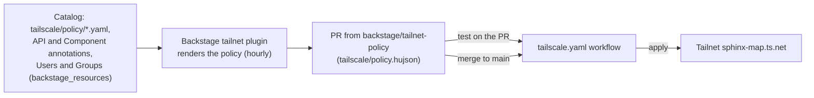

# Tailnet

Every homelab host, both Kubernetes clusters' proxies and the family's own
devices join one Tailscale tailnet, `sphinx-map.ts.net`. Buckle identifies its
agents by their Tailscale node, Ceph and labk3s run over it, and the homelab's
web UIs and APIs are published on it as Tailscale Services.

Who may reach what is one policy file,
[`tailscale/policy.hujson`](https://github.com/SpechtLabs/homelab/blob/main/tailscale/policy.hujson).
Nobody edits it by hand: Backstage renders it from the catalog and keeps a pull
request open with the result, and a GitHub workflow tests that pull request
against the tailnet and applies the policy once it's merged.

## The parts

| Part | What it is | Where it lives |
|---|---|---|
| The policy | grants, SSH rules, tags, auto approvers, tests | rendered into `tailscale/policy.hujson`; source in [`tailscale/policy/`](https://github.com/SpechtLabs/homelab/tree/main/tailscale/policy) and the catalog's annotations |
| Tailscale Services | `svc:buckle`, `svc:nas`, `svc:labk3s`, `svc:lgtm` and nine more | definitions in the admin console; served by hosts and by the clusters' `tailnet-ingress` ProxyGroups |
| tsidp | the tailnet's OIDC provider, device `idp` on isa, public through Funnel | [`modules/tsidp`](https://github.com/SpechtLabs/homelab/tree/main/modules/tsidp) |
| TKA | cluster sign-in for both clusters (devices `tka`, `lab-tka`) | SpechtLabs/k8s-deployment `apps/tka` |
| The jumphost | a Pi 5 allowed to open Tailscale SSH sessions to the rest | `tag:jumphost` |
| tailscaled | installed and kept current on every Debian host | [`modules/tailscale`](https://github.com/SpechtLabs/homelab/tree/main/modules/tailscale) |
| People and groups | Backstage Users and Groups | the private [SpechtLabs/backstage_resources](https://github.com/SpechtLabs/backstage_resources/blob/main/catalog/org.yaml) |

In Backstage: the **Tailscale** page (sidebar) and the Policy tab of
[`tailscale:sphinx-map`](https://backstage.k8s.specht-labs.de/catalog/default/tailscale/sphinx-map)
show every rule, an access map and a "Preview access" view. Component, API,
Resource, Group and User pages carry a card with that entity's own tailnet
access.

## Where to start

- Something's unreachable: [Debug "I can't reach X"](how-to/debug-cant-reach-a-service.md).
- Someone needs access: [Give a group or tag access to a Service](how-to/give-a-group-or-tag-access-to-a-service.md)
  or [Add or remove a person](how-to/add-or-remove-a-person.md).
- Backstage opened a policy pull request: [Review and merge it](how-to/review-and-merge-the-policy-pull-request.md).
- New service to publish: [on a host](how-to/add-a-tailscale-service-on-a-host.md)
  or [from Kubernetes](how-to/expose-a-kubernetes-service-on-the-tailnet.md).
- New here: the [tutorial](tutorials/trace-a-grant-from-the-catalog-to-the-tailnet.md)
  follows one grant through the whole pipeline without changing anything.

The four sections:

- [Tutorials](tutorials/index.md): one guided, read-only walk through the pipeline.
- [How-to guides](how-to/index.md): recipes for the day-to-day changes.
- [Reference](reference/index.md): Services, tags, groups, annotations, rules, files.
- [Explanation](explanation/index.md): why the policy looks the way it does, and how it got here.

Related systems: the [fleet](https://backstage.k8s.specht-labs.de/docs/default/system/fleet/)
(Buckle, which enrols hosts onto the tailnet),
[labk3s](https://backstage.k8s.specht-labs.de/docs/default/system/labk3s/) and
[Ceph](https://backstage.k8s.specht-labs.de/docs/default/system/ceph/), both of
which run over it.
