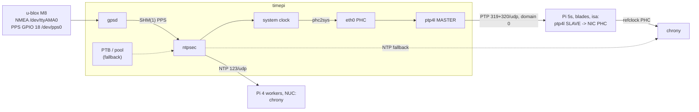

# Timekeeping

timepi, a Raspberry Pi 5 with a u-blox M8 GPS receiver on a HAT, is the home LAN's only stratum 1 NTP server and its PTP grandmaster. Every other host on the LAN runs chrony and follows it: by PTP with hardware timestamps where the network card can do that (the Pi 5s, the CM4 blades and isa), by NTP everywhere else (the Pi 4 workers and the NUC). The public pool is the fallback when timepi doesn't answer.

Measured accuracy: PTP clients sit within ~10-70 ns of timepi, NTP clients within microseconds. timepi itself is within ~1 µs of GPS while the receiver has a fix and drops to ~1 ms (PTB's servers over the internet) when it doesn't, which happens several times a day because the antenna sees little sky.

## The parts

| Part | Runs on | Defined in |
|------|---------|------------|
| Time server: gpsd, ntpsec, phc2sys, ptp4l, `ptp-gm-quality`, `time-metrics` | timepi | [`modules/ptp-server`](https://github.com/SpechtLabs/homelab/blob/main/modules/ptp-server/module.yaml) |
| GPS/PPS wiring in `config.txt` (UART, PPS overlay on GPIO 18, no serial console) | timepi | [`modules/pi-firmware`](https://github.com/SpechtLabs/homelab/blob/main/modules/pi-firmware/module.yaml), `rpi_gps_pps: true` in [`vars/host-timepi.yaml`](https://github.com/SpechtLabs/homelab/blob/main/vars/host-timepi.yaml) |
| Time clients: chrony, ptp4l (PTP clients only), `time-client-metrics` | every host on the LAN | [`modules/time-sync`](https://github.com/SpechtLabs/homelab/blob/main/modules/time-sync/module.yaml) |
| The fact that decides NTP or PTP (`host.facts.script.ptp`) | every Debian/Ubuntu host | [`modules/ptp-facts`](https://github.com/SpechtLabs/homelab/blob/main/modules/ptp-facts/module.yaml) |
| Groups `ptp-grandmaster`, `ntp-client`, `ptp-client` | Buckle server | [`buckle.yaml`](https://github.com/SpechtLabs/homelab/blob/main/buckle.yaml) |
| Alerts, SLOs, the Time Server dashboard | Grafana Cloud | SpechtLabs/k8s-deployment, see [Alerts, SLOs and dashboards](reference/alerts-slos-and-dashboards.md) |

Buckle rolls all of it out from this repo; see the [Fleet docs](https://backstage.k8s.specht-labs.de/docs/default/system/fleet/) for how rollouts work.

## Where to start

- An alert fired: [Respond to a time-sync alert](how-to/respond-to-a-time-sync-alert.md).
- You want to know if a host is in sync and how: [Check a host's time sync](how-to/check-a-hosts-time-sync.md).
- timepi is down or won't boot: [Recover timepi when it doesn't boot](how-to/recover-timepi-when-it-doesnt-boot.md). Before you reboot it on purpose, read [Reboot timepi safely](how-to/reboot-timepi-safely.md).
- New to this setup: walk through [Follow the time from GPS to a client](tutorials/follow-the-time-from-gps-to-a-client.md) once.
- Why it's built like this: [Design](explanation/design.md) and [timepi's boot setup](explanation/timepi-boot-setup.md).

The four sections:

- [Tutorials](tutorials/index.md): one guided, read-only walk through the whole chain.
- [How-to guides](how-to/index.md): recipes for alerts, checks, recovery and new hosts.
- [Reference](reference/index.md): hosts, ports, config, metrics, alerts, known issues.
- [Explanation](explanation/index.md): design decisions and the NVMe boot history.
